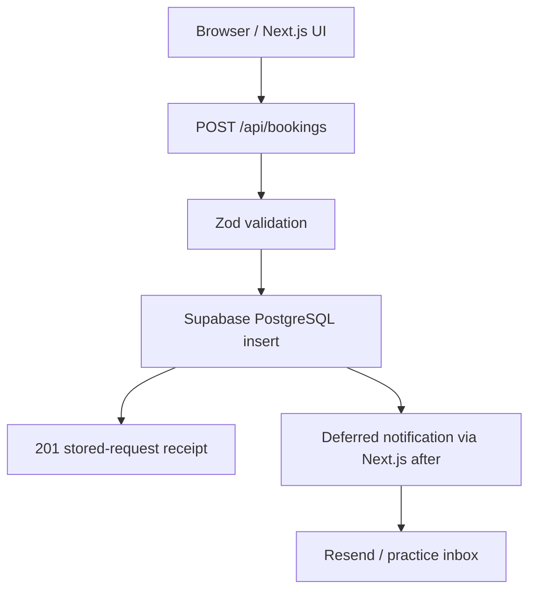
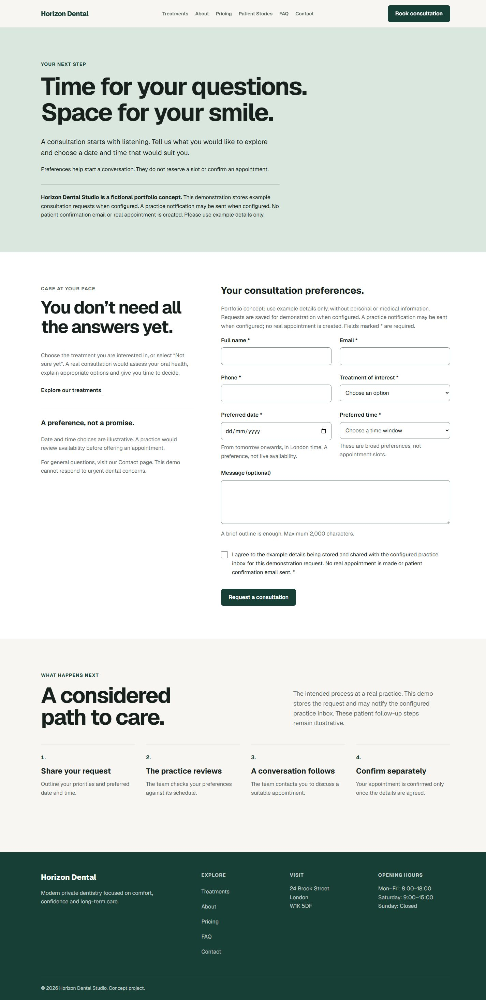

# Horizon Dental Studio

A concept website and consultation-request platform for a premium private dental practice. Built as a full-stack portfolio case study, from treatment discovery and patient-focused UX to validated PostgreSQL persistence and practice email notifications.

**Status:** Product phases 1–15 completed; documentation and portfolio captures prepared. 41 automated tests passed in the latest QA audit. Public deployment is pending. Horizon Dental Studio is fictional.


[Read the case study](docs/portfolio-case-study.md) · [Portfolio summary](docs/portfolio-summary.md) · [Freelance summary](docs/freelance-project-summary.md)

## Overview

The project serves prospective patients who want to understand treatments, compare indicative fees and request a consultation without pressure. For the fictional practice, the objective is to build confidence and turn informed interest into a clear, manageable consultation request.

## Business problem

A private practice needs more than an attractive homepage. Unclear treatment information, opaque pricing and a cumbersome enquiry process can prevent patients from taking the next step. This concept addresses those problems through readable information, visible demonstration disclosures and a focused booking journey.

## Solution

A responsive practice website brings together four treatment detail pages, pricing, team information, patient stories and a categorized FAQ. A validated contact demo demonstrates enquiry handling; the separate booking workflow stores consultation requests in Supabase and sends a best-effort notification to the practice through Resend.

A request is **not a confirmed appointment**. The contact demo sends and stores nothing, and the booking system does not send patient confirmation emails.

## Key features

### Patient experience

- Responsive navigation, treatment discovery and reusable treatment detail pages.
- Indicative pricing, practice/team content and visibly fictional patient stories.
- Categorized native FAQ disclosures, contact guidance and consultation requests.
- Accessible form feedback, clear pending states and useful recovery actions.

### Booking system

- Shared Zod validation in the browser and API, with authoritative server checks.
- Future-date validation using the practice's London calendar date, consent and bounded input.
- In-flight duplicate-submit prevention and validated Supabase inserts.
- Checked response shapes, retained entries on failure and retry support.
- Deferred practice notifications that cannot overturn a successfully stored request.

### Quality

- Page metadata, canonicals, sitemap, robots and generated Open Graph imagery.
- Responsive image sizing, static generation and restrained client-side interactivity.
- Keyboard/focus support, reduced-motion CSS, error boundaries and a custom 404.
- 41 automated tests, documented browser checks and explicit remaining limitations.

## Tech stack

| Technology | Role |
| --- | --- |
| Next.js 16 / App Router | Routes, server rendering, API handlers, metadata and image optimization |
| React / TypeScript | Reusable UI and typed application contracts |
| Plain CSS | Responsive layouts, interaction states and the practice's visual language |
| Zod | Shared request validation and booking response validation |
| Supabase PostgreSQL | Persistent consultation requests through server-only access |
| Resend | Optional practice notification delivery |
| Node.js 22 | Development, build and native test runner; tested on v22.23.2 |
| Vercel | Intended deployment target; public deployment is pending |

No Tailwind or additional UI framework is used.

## Architecture



Persistence is the source of truth. Only a successful database write produces a stored-request receipt. Notification work is scheduled after persistence; missing email configuration, scheduling errors and provider failures leave that receipt valid.

Supabase and Resend modules are server-only. Privileged credentials never enter browser code. There is no public booking-read endpoint. This is best-effort email delivery, not a durable background queue.

## Project structure

```text
src/
  app/          Pages, treatment routes, API handlers, metadata and recovery UI
  components/   Shared navigation, cards, forms and reusable UI
  data/         Treatments, team, testimonials, pricing and categorized FAQs
  lib/          Validation, persistence, notifications and SEO helpers
  proxy.ts      Unknown treatment-route handling
supabase/       Booking table setup SQL
tests/          Node test-runner suites
docs/           Accessibility, performance, visual and final QA audits
public/images/  Practice and team image assets
```

## Implementation decisions

- **Data-driven treatments:** the dynamic treatment route, pricing references and related links reuse shared treatment data rather than separate page copies.
- **Validation at both boundaries:** shared schemas improve client feedback; the API independently validates every submission and strips unexpected fields. Client checks never authorize persistence.
- **Explicit form contracts:** booking response validation prevents malformed responses from becoming false success states. Failures release pending state and retain entries.
- **Server-only provider access:** privileged database and email operations remain behind API handlers. Provider details and submitted values are excluded from visitor-facing errors.
- **Framework-native delivery:** metadata helpers, sitemap/robots routes, optimized images and static generation use existing Next.js capabilities.
- **Accessible interaction:** native FAQ disclosures, semantic structure, visible focus states and reduced-motion rules keep ordinary interactions understandable without extra libraries.

## Database

[Booking setup SQL](supabase/bookings.sql) creates `public.bookings` with:

- A generated UUID primary key.
- Name, email, phone, treatment, optional message and required consent.
- Preferred date and one of four preferred time windows.
- A status initially set to `pending` and a creation timestamp.
- Database constraints, enabled Row Level Security and no table access for public, anonymous or authenticated client roles.

The application uses a server-side service-role credential for inserts. That credential is privileged and must stay secret; RLS is not a substitute for protecting it. No public database reads are exposed.

The SQL is a one-time setup for a new project. It intentionally fails if the table already exists rather than altering or deleting existing data.

## Environment variables

Copy [`.env.example`](.env.example) to `.env.local`. The local file is ignored by Git; the example contains names and guidance only.

| Variable | Scope | Requirement / purpose |
| --- | --- | --- |
| `SUPABASE_URL` | Server configuration | Required for booking submissions; the project's base URL, without `/rest/v1/` |
| `SUPABASE_SERVICE_ROLE_KEY` | Server-only secret | Required for booking persistence; never use a `NEXT_PUBLIC_` prefix |
| `RESEND_API_KEY` | Server-only secret | Optional notification feature |
| `BOOKING_NOTIFICATION_EMAIL` | Server configuration | Trusted practice recipient; one bare email address |
| `BOOKING_FROM_EMAIL` | Server configuration | Resend-authorized sender; one bare email address |
| `NEXT_PUBLIC_SITE_URL` | Public configuration | Actual website origin; required before publishing, optional locally |

All three notification settings are needed to enable practice email. Missing settings or invalid addresses skip notification without failing a stored booking. Database/email configuration is not required to build or browse the informational pages.

The public site origin must have no path, credentials, query or fragment; production requires a public HTTPS origin. Local development defaults to localhost. Unconfigured production uses a reserved `.example` origin, so set the real origin and rebuild before release.

## Local setup

Use Node.js 22; the verified environment is **v22.23.2**.

1. Clone this repository using its actual URL. `<repository-url>` below is a placeholder; no remote URL is currently configured.
2. Install dependencies and copy the environment template:

   ```powershell
   git clone <repository-url> horizon-dental-studio
   cd horizon-dental-studio
   npm install
   Copy-Item .env.example .env.local
   ```

3. Create your own Supabase project, enable its Data API with the public schema, and populate the two server-side Supabase settings. Run the **contents** of [`supabase/bookings.sql`](supabase/bookings.sql) once in the project's SQL Editor. A filename is not SQL; do not drop an existing table to rerun setup.
4. Optionally configure Resend with an API key, an authorized sender on a verified domain and a trusted practice recipient. Both email settings accept bare addresses, not display-name strings. Resend's test sender has recipient restrictions; use provider-approved settings for your account.
5. Run `npm run dev` and open localhost on port 3000. Restart the development server after changing environment settings.

Use fictional request data when exercising this portfolio project.

## Available commands

| Command | Purpose |
| --- | --- |
| `npm run dev` | Start the development server |
| `npm run build` | Create the production build |
| `npm start` | Serve the production build |
| `npm run lint` | Run ESLint |
| `npx tsc --noEmit` | Check TypeScript without emitting files |
| `node --test tests/*.test.mjs` | Run the automated test suites |

The package has no `npm test` script.

## Testing and verification

The [Phase 15 final QA audit](docs/final-qa-audit.md), dated 10 October 2026, records **41/41 tests passing**, lint and TypeScript passing, and a successful production build.

Coverage includes request validation, persistence outcomes, notification configuration/delivery failures, response handling, retry and duplicate-submit behavior, resilience, content, accessibility, SEO and performance assertions. Provider failure cases use mocks; they were not induced against live services.

The audit also records one fictional live booking, a verified Supabase row and a matching Resend delivery event. Delivery confirms recipient-server acceptance, not independent verification of inbox placement.

Chromium checks covered 12 public pages plus the custom 404 at **320, 390, 768, 1024 and 1440px**: 65 route/viewport combinations. Routes, links, assets, metadata and keyboard interactions were checked. Firefox/WebKit, true 200% browser zoom, OS reduced-motion switching and a screen-reader smoke test were unavailable and remain follow-up work.

## Accessibility

The implementation includes keyboard navigation, a skip link, visible focus outlines, associated form labels/hints/errors, live feedback, native `details`/`summary` FAQs and focusable category anchors. Contrast and responsive reflow were checked; CSS respects reduced motion.

See the [accessibility audit](docs/accessibility-audit.md) and [final QA audit](docs/final-qa-audit.md) for evidence and limits. These checks do not constitute formal WCAG certification.

## SEO

Shared helpers generate page titles, descriptions, canonicals, Open Graph and Twitter metadata. Treatment metadata comes from the same data as its page content. Native Next.js sitemap and robots routes cover the public site.

Because the practice and testimonials are fictional, the project avoids structured business/review claims that could imply a real clinic or verified reviews. Set `NEXT_PUBLIC_SITE_URL` to the real deployed origin before publishing.

## Performance

Informational content uses static generation and partial prerendering where applicable. Images use Next.js optimization with sizes matched to actual layouts; interactive client components are kept focused.

The [performance audit](docs/performance-audit.md) records removal of unused Geist Mono, reducing loaded font bytes from **52,396 to 29,288**. At the measured 390px viewport, the homepage hero's optimized WebP decreased from **26,092 to 13,004 bytes** after image sizing changes. These are specific measured improvements, not Lighthouse scores or guarantees for every device.

## Error handling and resilience

Route and root error boundaries provide safe recovery UI; unknown routes use a custom 404. API failures return controlled messages rather than provider internals. Supabase configuration and insert failures are normalized, and forms support retry while retaining entries.

A saved request remains successful even if notification fails. In-flight submission guards do not provide cross-request idempotency: if a response is lost after persistence, receipt can be uncertain. Inspect the stored request before submitting it again.

## Screenshots

The desktop homepage above introduces the practice. The mobile view below shows the introduction, consultation links and complete hero image at approximately 390px.


<details>
<summary>View the consultation-request page</summary>

Blank booking form with clear consent, preferences and demonstration disclosures.



</details>

[Browse all ten screenshots](docs/screenshots/README.md): homepage desktop/mobile, Treatments, Dental Implants, About, Pricing, Patient Stories, FAQ, Contact and Booking.

Captured from the local production build in Chromium. JPEG files reflect the browser's export format; full-page feature captures are available in the gallery. Booking success is omitted to avoid an extra live submission solely for a screenshot. No new database rows or emails were created in this phase.

## Live demo

**Deployment pending.** Vercel is the intended target. Add the verified public demo URL here after deployment and origin configuration; no live URL is claimed yet.

## Challenges and engineering decisions

The central booking challenge was separating durable receipt from optional notification. Database-first persistence and deferred email let the UI accurately confirm storage even when delivery is unavailable.

Shared treatment data avoids mismatched prices, names and route links. Shared validation avoids divergent rules, while server validation protects the write boundary. Native disclosures and restrained CSS preserve a calm visual experience without sacrificing keyboard access or responsive readability.

## Future improvements

- Durable notification queue, retries and operational delivery visibility.
- Idempotency for submissions whose responses are lost or uncertain.
- Real appointment availability and an authenticated practice dashboard.
- Patient confirmation emails and CMS-based content editing.
- Cross-browser, screen-reader, true zoom and OS preference testing.
- Abuse controls, privacy/retention policies and operational review before handling real patient data.

## Audit documentation

The historical reports retain the scope and test counts of their respective phases:

- [Accessibility audit — Phase 11](docs/accessibility-audit.md)
- [Performance audit — Phase 12](docs/performance-audit.md)
- [Visual polish audit — Phase 13](docs/visual-polish-audit.md)
- [Final QA audit — Phase 15](docs/final-qa-audit.md)

## Concept disclaimer

Horizon Dental Studio is a fictional practice. Names, testimonials, pricing, clinic details and treatment journeys are demonstration content. This repository is a portfolio and product-development case study, not a real dental service or a source of medical advice.
