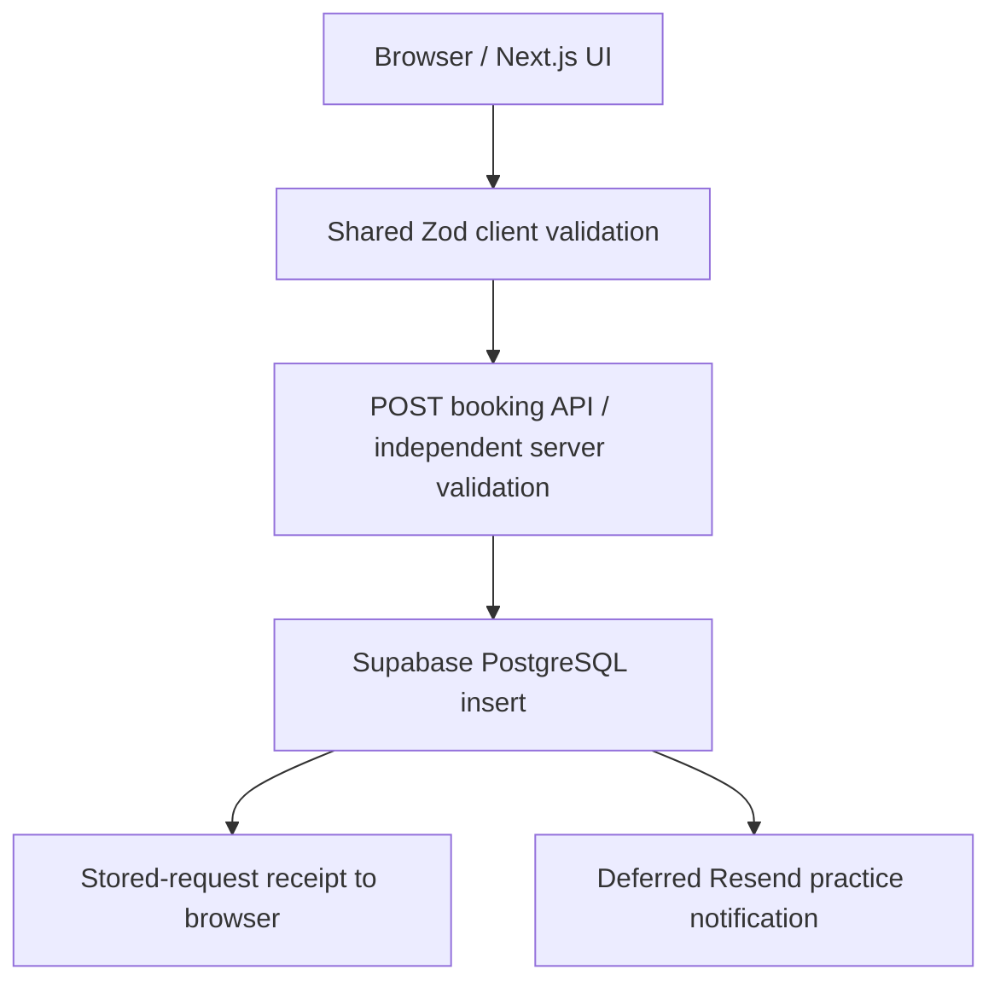
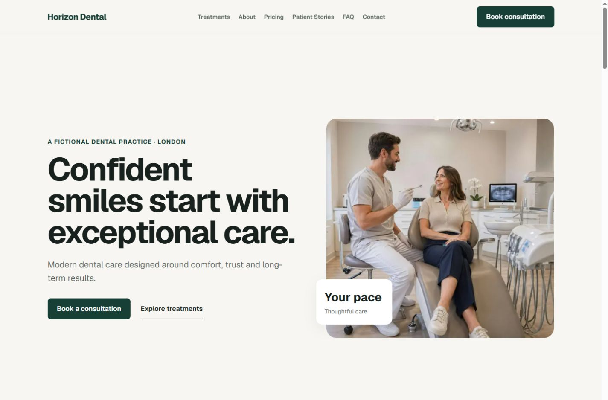
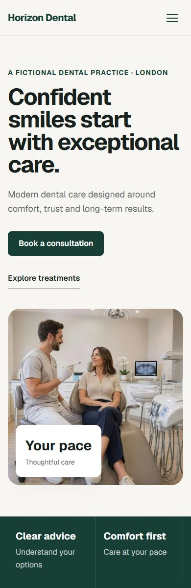

# Horizon Dental Studio

## Project Summary

Horizon Dental Studio is a fictional private dental practice website and consultation-request platform. It combines clear treatment information and a calm responsive interface with validated database persistence and optional practice email notifications.

## Project Type

- Fictional concept project and portfolio case study.
- Full-stack product and website development; no real client relationship is claimed.
- [Public concept demo](https://horizon-dental-studio.vercel.app) · [GitHub repository](https://github.com/ayofital/horizon-dental-studio).

## Role

Product Developer, Frontend Developer and Backend/API Developer, with responsibility for UX and technical decisions. The work covers product scope, content architecture, reusable UI, request validation, persistence, notifications and quality verification.

## The Problem

The fictional practice needed a stronger digital presence: easier treatment discovery, clearer fees, credible explanations of care and less friction when requesting a consultation. Trust needed to come from useful information and thoughtful interactions, without invented awards, verified reviews or business results.

## Goals

- Help visitors understand treatments and choose a sensible next step.
- Make starting prices visible while explaining assessment-dependent costs.
- Build confidence through practice, team, story and FAQ content.
- Deliver a genuine consultation-request workflow with reliable storage.
- Keep the mobile experience readable, accessible and easy to navigate.

## Solution

The product includes a homepage, treatment index and four treatment detail routes, About, Pricing, Patient Stories, FAQ, Contact and Booking. Shared content keeps treatment names, prices and links consistent.

The contact form is explicitly a non-persistent demonstration. Booking is a separate working flow: validated requests are stored in Supabase PostgreSQL, then a best-effort notification is sent to the configured practice inbox through Resend. Requests do not reserve appointments, and the project sends no patient confirmation email.

## Product Thinking

**A clear next step.** Consultation links appear alongside relevant information and at page endings, so visitors can act after understanding their options.

**Pricing as guidance.** Starting fees and visible disclaimers set expectations without implying a guaranteed quote.

**Content that stays consistent.** Reusable treatment data supports discovery cards, dynamic detail routes and related references. Team, testimonial and FAQ data are shared rather than copied into pages.

**Mobile readability.** Navigation, card layouts, form controls, wrapping and CTA spacing were reviewed across narrow and wide viewports.

**Honest confirmation.** A successful request means the database accepted it. Optional email delivery and actual appointment confirmation are separate outcomes.

**Clear concept boundaries.** Fictional practice and testimonial disclosures are visible. The contact demo describes exactly what it does and does not send.

## Technical Architecture

Next.js App Router serves the pages and API handlers. Dynamic treatment routes derive content and metadata from shared data. Zod validates input on both sides of the API boundary; booking responses are also checked before the UI displays success.

Privileged Supabase and Resend credentials remain in server-only modules. The booking table has RLS enabled and no public client table access. No public booking-read endpoint is exposed.

Persistence is authoritative. Deferred notification failure cannot reverse a stored request; missing database configuration or failed inserts cannot return stored success. Recovery UI and safe API messages support understandable failures.

## Key Features

### Patient experience

Responsive navigation; treatment discovery; indicative pricing; practice/team content; fictional patient stories; categorized native FAQ disclosures.

### Requests

Accessible consultation form, consent, future-date checks, in-flight duplicate prevention, persistent requests and optional practice notifications. Contact remains a clearly labeled demo.

### Product quality

Metadata and social previews, sitemap/robots, responsive images, keyboard and focus support, reduced-motion CSS, custom 404 and route/root recovery UI.

## Technical Highlights

- Next.js 16 App Router, React and TypeScript with plain CSS.
- Data-driven dynamic treatment routes and reusable content structures.
- Shared Zod rules with independent server enforcement.
- Server-only Supabase access, constrained booking fields and RLS.
- Best-effort Resend notifications scheduled after successful persistence.
- Shared metadata/canonical generation and native sitemap/robots routes.
- Accessible forms, semantic page structure and native FAQ behavior.
- Image sizing and removal of an unused font to reduce measured payloads.
- Safe errors, response validation and a 41-test suite.

See the [repository README](../README.md) for setup and implementation details.

## Challenges

**Avoiding content drift:** one treatment source supports multiple views instead of separately maintained route content.

**Protecting the write boundary:** browser feedback improves usability, but the API repeats validation before calling the database.

**Separating receipt from delivery:** database-first storage and deferred notification keep confirmation truthful when email fails.

**Maintaining responsive consistency:** shared styles and targeted refinements address wrapping, spacing, image crops and navigation across page types.

**Handling failure without leaking internals:** provider errors become controlled messages; forms release pending state and retain entries for retry.

## What I Learned

- Define the difference between a request, receipt and confirmed appointment before implementing a booking flow.
- Treat reusable content as an application contract: names, prices, slugs and metadata need to agree.
- Separate client feedback from server authorization and keep provider credentials behind server-only boundaries.
- Validate responses as well as requests to avoid false success after malformed or interrupted communication.
- Include accessibility, SEO and failure recovery in acceptance checks rather than treating them as final decoration.

## Results

The completed concept includes 12 public routes and a responsive request experience. Phase 15 verified a live Supabase insert and a matching Resend delivery event using a fictional fixture.

The [final QA audit](final-qa-audit.md) records **41/41 passing tests**, successful lint and TypeScript checks, and a successful production build. Chromium checks covered 12 public pages plus custom 404 at 320, 390, 768, 1024 and 1440px: 65 route/viewport combinations.

[Accessibility](accessibility-audit.md), [performance](performance-audit.md) and [visual polish](visual-polish-audit.md) reports document the work and its limits. Firefox/WebKit, screen-reader, true 200% zoom and OS reduced-motion preference checks remain outstanding. No conversion, revenue or patient-outcome metrics are claimed.

## Screenshots

Desktop homepage: the practice positioning and consultation entry point.

Mobile homepage: readable introduction and treatment-room imagery at approximately 390px.

Booking: consultation preferences with clear demonstration and appointment limitations.

[View the full booking page](screenshots/booking.jpg) · [Browse all ten screenshots](screenshots/README.md)

Captures use the existing local production build. No new booking was submitted for screenshots; a success-state image is not included.

## Stack

Next.js 16, React, TypeScript, plain CSS, Zod, Supabase PostgreSQL, Resend and Node.js 22. The public concept demo is deployed on Vercel with Node.js 22.

## Future Improvements

Durable email queues/retries; cross-request idempotency; real appointment availability; an authenticated practice dashboard; patient confirmation emails; CMS editing; and broader browser, screen-reader and preference testing. Abuse prevention and privacy/retention review would precede use with real patient data.

## Project Disclaimer

Horizon Dental Studio is fictional. Practice details, names, testimonials, pricing and treatment journeys are demonstration content. This is a portfolio case study, not a real client engagement or dental service.
